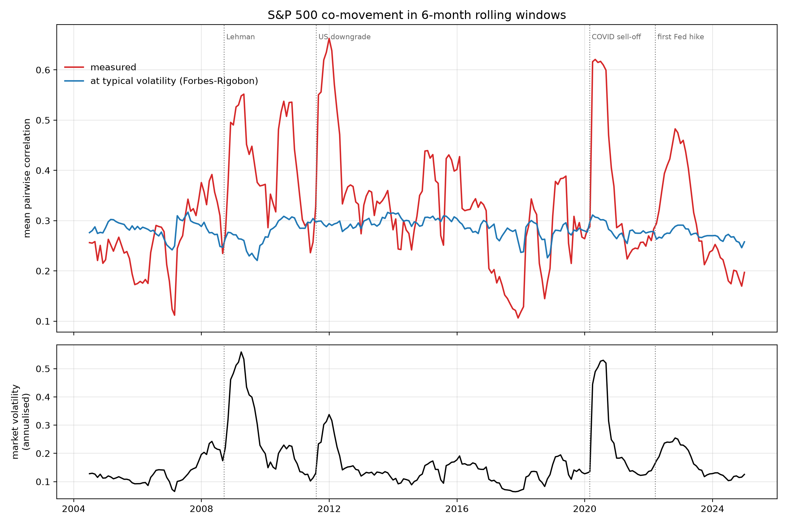
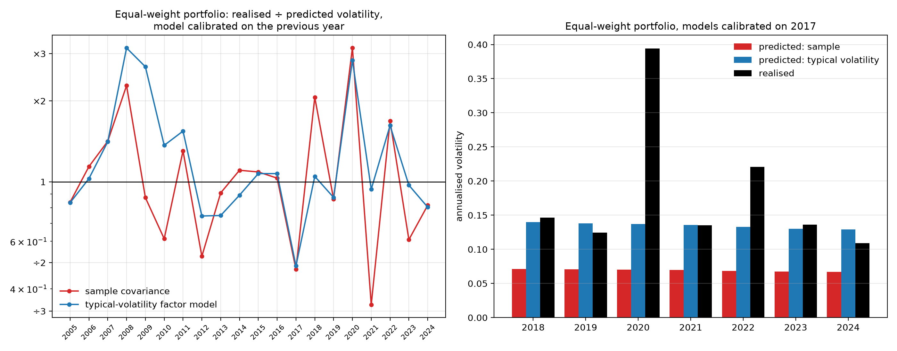
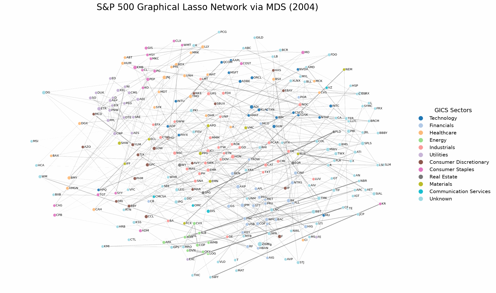

# Do stocks really become more connected in a crisis?

[](https://github.com/404-ammar-not-found/Changes-in-Stock-Market-Structure/actions/workflows/tests.yml)


I studied how the stocks in the S&P 500 moved together from 2004 to 2024, including the 2008
crisis, COVID and the 2022 rate shock. The data is daily prices for about 870 tickers with the
index's historical membership, so the companies that failed in 2008 stay in.

Average correlation between stocks more than doubles in a crisis, but almost all of that rise
disappears once you adjust for volatility. The whole market moves more violently, and the links
between individual stocks barely change.


## Findings

| | Finding | Evidence |
|---|---|---|
| 1 | Average correlation varies four-fold, from 0.13 in 2017 to 0.55 in both 2011 and 2020 | 95% bootstrap confidence intervals for each year |
| 2 | The co-movement comes from a single market factor | The first principal component's share of variance tracks mean correlation to within 0.035 every year |
| 3 | At typical volatility every year sits between 0.23 and 0.30; none of the 2005 to 2008 rise and 3% of the 2017 to 2022 rise remain | Forbes-Rigobon volatility adjustment |
| 4 | In 2010, 2011 and 2020 the network of links between stocks is no denser than in simulated markets driven only by beta | Graphical Lasso against a one-factor null |
| 5 | Most of the remaining links are sector exposure; what sectors don't explain is a thin layer of pair-specific links, visible only in calm years | Fat-tailed and market-plus-sector nulls |
| 6 | Correlation rose after Lehman, not before it, and jumped from 0.29 to 0.62 within a month in March 2020 | Six-month rolling windows |

## What it means in practice

A risk model calibrated on 2017 understated the realised volatility of an equal-weight portfolio
of these stocks by 3.2 times in 2022 and 5.6 times in 2020. Resetting the model to typical
volatility halved those misses, but no model calibrated a year ahead saw either crisis coming, and
optimised minimum-variance portfolios were understated in every year by more than any volatility
effect.

In a crash the index behaves like one large bet on the market, so adding more S&P stocks does
little for protection. Treasuries rose 34% while the index fell 37% in 2008, but in 2022 long
Treasuries fell 31% alongside it. Protection from outside the index depends on what is causing the
fall.

When stocks start moving together, it is worth checking whether volatility explains it before
concluding that the market has changed. In this data it explained nearly all of it.

## Approach

```
Polygon API ─► coverage check ─┐
yfinance (2019-2021 gap) ──────┼─► split reconciliation + overlap check ─► SQLite
                               │
     ┌─────────────────┬───────┴──────────┬─────────────────┬──────────────────┐
     ▼                 ▼                  ▼                 ▼                  ▼
 Correlation      Forbes-Rigobon    Graphical Lasso    Out-of-sample      Treasuries
 + PCA, yearly    volatility        vs one-factor,     risk forecasts     and gold
 and rolling      reset             t and sector nulls
```

| Question | Method |
|---|---|
| How much do stocks move together? | Mean pairwise correlation of daily log returns, with bootstrap confidence intervals, per year and in six-month rolling windows |
| Does one factor explain it? | Share of variance explained by the first principal component |
| How much of a spike is volatility? | Each year's correlation re-estimated with market and idiosyncratic volatility reset to typical levels (Forbes and Rigobon, 2002) |
| Are there links beyond the market factor? | Partial correlations from the Graphical Lasso, compared with simulated one-factor markets (Gaussian and fat-tailed) and market-plus-sector markets |
| Do stocks group by sector? | Affinity Propagation, with hyperparameters fixed across years so cluster counts can be compared |
| Would it have changed a risk forecast? | Covariance models calibrated on one year, scored on the next year's realised volatility |
| Did anything outside the index protect? | Yearly correlation and returns of Treasury and gold ETFs against the S&P 500 |

## Data problems I had to solve

The data needed about as much work as the modelling.

- Once a request went past the account's history limit, Polygon returned only about 40% of trading
  days and still answered `200 OK`. I found this by comparing row counts with the trading calendar,
  re-pulled what was still available, and added a completeness check to the pipeline.
- To see how much the gaps mattered, I removed days from the complete 2022-2024 data in the same
  pattern as the sparse years. The bias was about +0.03, so the trend over time holds and the
  earlier levels read slightly high.
- Polygon no longer serves 2019-2021 on this account, so I filled the gap from yfinance. Each ticker
  is rescaled onto the panel's prices and only used if it matches Polygon on overlapping dates, which
  caught BB&T: it renamed itself Truist, and its old symbol now belongs to a different security.
- Filters that looked like routine hygiene removed short-lived stocks three times: a coverage
  threshold that dropped Bear Stearns, Merrill Lynch, Wachovia, National City and Countrywide; the
  same threshold later dropping 2024 additions such as Palantir and CrowdStrike; and a symbol
  mismatch (`BRK-B` against `BRK.B`) that silently left Berkshire Hathaway out of every year. All
  three are fixed, and the results now report how many full-year members are missing per year.
- The volatility adjustment originally mixed per-observation variances from sparse and complete
  years, which made the adjusted series drift upwards after 2019. Rolling windows exposed it, and
  annualising the variances fixed it.
- In 2011 there were 416 stocks and only 105 observed days, so the sample covariance matrix is
  singular and has to be regularised. I tuned the penalty once on pooled data and kept it fixed, so
  the estimator is the same in every year and changes between years come from the market.

## Figures

| Rolling correlation and volatility | Out-of-sample risk |
|---|---|
|  |  |

| Stock network by year (coloured by sector) | Clusters by year |
|---|---|
|  |  |

Each stock keeps the same position in every frame, so the layout cannot create movement between
years.

## Tech stack

Python, pandas, NumPy, scikit-learn (Graphical Lasso, Affinity Propagation, MDS, factor analysis,
Ledoit-Wolf), SciPy, matplotlib, SQLite, yfinance, pytest and GitHub Actions.

## Reproducing the results

```bash
python -m venv .venv && source .venv/bin/activate
pip install -r requirements-dev.txt
pytest                                    # estimator self-checks on synthetic data, runs in seconds

python -m src.results                     # headline table
python -m src.forbes_rigobon              # volatility counterfactual
python -m src.one_factor_null --sims 200  # structure-beyond-beta test (about an hour)
python -m src.rolling                     # six-month rolling windows
python -m src.oos_risk                    # out-of-sample risk test
python -m src.cross_asset                 # Treasuries and gold
python -m src.plot_summary                # summary figure
```

`data/` is too large to commit. To rebuild it, put a `POLYGON_KEY` in `.env` and follow the
[Method](docs/analysis.md#method). The tests don't need the data, because they check each estimator
on synthetic data where the correct answer is known.

## Repository layout

```
├── notebooks/   # 01 data prep → 02 networks → 04 results → 05 volatility → 06 beyond beta → 07 extensions
├── src/         # pipeline and analysis modules, importable by notebooks and scripts
├── tests/       # pytest self-checks on synthetic limiting cases
├── figures/     # result tables (CSV), figures, animations
└── docs/        # full write-up with every table and caveat
```

Notebook 03 is early exploration and the results don't depend on it.

## Limitations

- Before 2019 about 40% of trading days are present. The bias this causes is measured above.
- 2019-2021 come from yfinance, which no longer serves companies delisted since, so 36 to 50
  full-year members are missing from each of those years (13 to 53 per year before 2019, for other
  reasons). Dropping the same stocks from complete years moves the result by less than 0.003.
- The volatility adjustment assumes a one-factor model, and the sector null relies on yfinance's
  sector labels, which cover 70% of tickers.
- The analysis is descriptive. It makes no causal claim and does not test a trading strategy.

The full method, every table and all the caveats are in [docs/analysis.md](docs/analysis.md).

## Credits

Historical constituents come from
[hanshof/sp500_constituents](https://github.com/hanshof/sp500_constituents), prices from the Polygon
API, and 2019-2021 prices and ETF returns from yfinance. I wrote the analysis and modelling, with AI
assistance for the repository restructure, the null-simulation and volatility-adjustment
implementations, the extensions and the documentation. None of this is financial advice.
