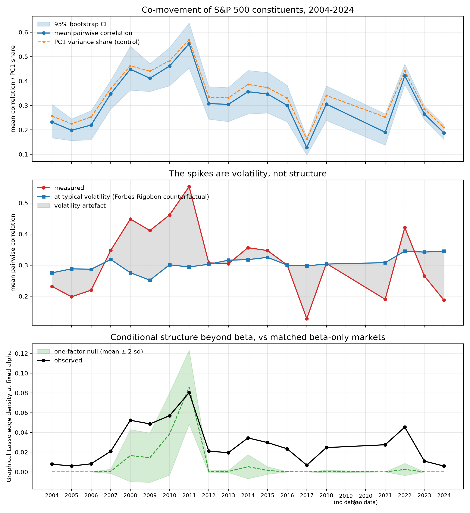
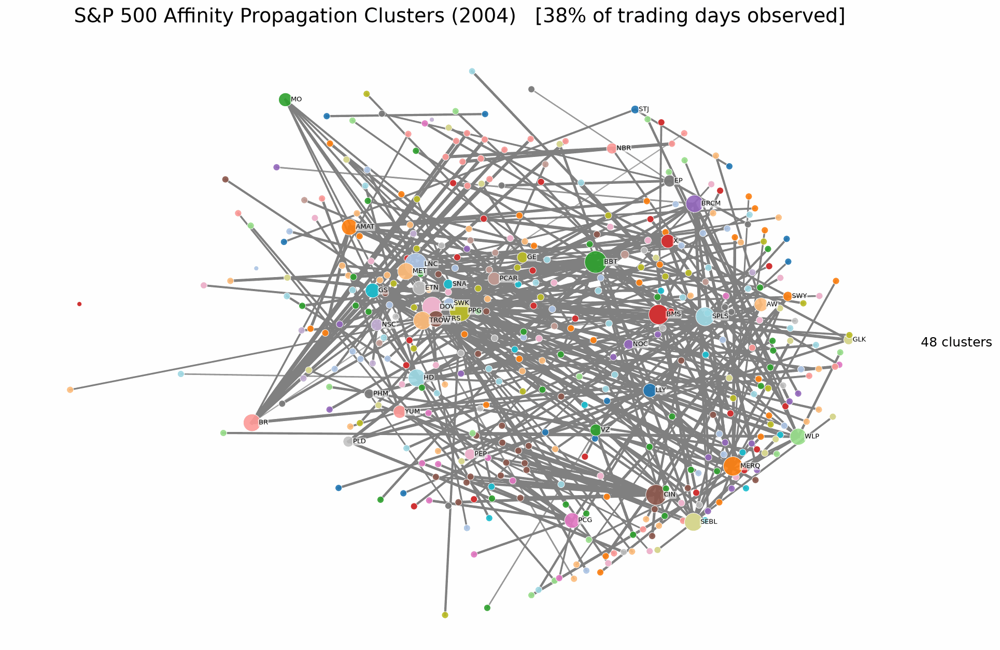

# Do stocks really become more connected in a crisis?

[](https://github.com/404-ammar-not-found/Changes-in-Stock-Market-Structure/actions/workflows/tests.yml)


I studied how the stocks in the S&P 500 moved together from 2004 to 2024, using daily prices for
about 870 tickers and the index's historical membership, so the companies that failed in 2008 stay
in the data.

Average correlation between stocks more than doubles in a crisis, but almost all of that rise
disappears once you adjust for volatility. The whole market moves more violently, and the links
between individual stocks barely change.



## Findings

| | Finding | Evidence |
|---|---|---|
| 1 | Average correlation varies four-fold, from 0.13 in 2017 to 0.55 in 2011, with high years in 2008-2011 and 2022 | 95% bootstrap confidence intervals for each year |
| 2 | The co-movement comes from a single market factor | The first principal component's share of variance tracks mean correlation to within 0.02 every year |
| 3 | At typical volatility every year sits between 0.25 and 0.35, and none of the 2005 to 2008 rise remains | Forbes-Rigobon volatility adjustment |
| 4 | In 2010 and 2011 the network of links between stocks is no denser than in 200 simulated markets driven only by beta | Graphical Lasso compared with a one-factor null |
| 5 | In 17 of 19 years a small, stable set of real links shows up, such as share classes, duopolies and spin-offs | The same null test |

## What it means in practice

A risk model calibrated on 2017's correlations would have understated 2008- or 2022-style
co-movement by about three times, so stress tests should use crisis-year correlations.

In a crash the index behaves like one large bet on the market. Adding more S&P stocks does little
for protection, which has to come from assets that respond to something other than the stock market.

When stocks start moving together, it is worth checking whether volatility explains it before
concluding that the market has changed. In this data it explained nearly all of it.

## Approach

```
Polygon API ──► coverage check ──► splice + split reconciliation ──► SQLite
                                                                       │
     ┌──────────────────────┬───────────────────────┬──────────────────┤
     ▼                      ▼                       ▼                  ▼
 Correlation + PCA   Forbes-Rigobon        Graphical Lasso      Affinity Propagation
 (bootstrap CIs)     volatility reset      + one-factor null    clustering vs sectors
```

| Question | Method |
|---|---|
| How much do stocks move together? | Mean pairwise correlation of daily log returns, with 200-sample bootstrap confidence intervals |
| Does one factor explain it? | Share of variance explained by the first principal component |
| How much of a spike is volatility? | Each year's correlation re-estimated with market and idiosyncratic volatility reset to typical levels (Forbes and Rigobon, 2002) |
| Are there links beyond the market factor? | Partial correlations from the Graphical Lasso, compared with 200 simulated one-factor markets per year |
| Do stocks group by sector? | Affinity Propagation, with hyperparameters fixed across years so cluster counts can be compared |

## Data problems I had to solve

The data needed about as much work as the modelling.

- Once a request went past the account's history limit, Polygon returned only about 40% of trading
  days and still answered `200 OK`. I found this by comparing row counts with the trading calendar,
  re-pulled what was still available, and added a completeness check to the pipeline.
- To see how much the gaps mattered, I removed days from the complete 2022-2024 data in the same
  pattern as the sparse years. The bias was about +0.03, so the trend over time holds and the
  earlier levels read slightly high.
- Two coverage filters set at `>= 0.50` were silently removing Bear Stearns, Merrill Lynch,
  Wachovia, National City and Countrywide, which brought survivorship bias back in. Both thresholds
  now admit short-lived stocks, and each year's window is checked separately.
- Each data pull was split-adjusted as of its own date, which would have created fake returns where
  the two pulls join. Comparing overlapping dates found five real splits (APH, MNST, CRWD, DD, PARA),
  each confirmed by the change in trading volume.
- In 2011 there were 416 stocks and only 105 observed days, so the sample covariance matrix is
  singular and has to be regularised. I tuned the penalty once on the pooled data and kept it fixed,
  so the estimator is the same in every year and changes between years come from the market.

## Animations

| Stock network by year (coloured by sector) | Clusters by year |
|---|---|
|  |  |

Each stock keeps the same position in every frame, so the layout cannot create movement between
years.

## Tech stack

Python, pandas, NumPy, scikit-learn (Graphical Lasso, Affinity Propagation, MDS), SciPy,
matplotlib, SQLite, pytest and GitHub Actions.

## Reproducing the results

```bash
python -m venv .venv && source .venv/bin/activate
pip install -r requirements-dev.txt
pytest                                    # estimator self-checks on synthetic data, runs in seconds

python -m src.results                     # headline table
python -m src.forbes_rigobon              # volatility counterfactual
python -m src.one_factor_null --sims 200  # structure-beyond-beta test (~30 min)
python -m src.plot_summary                # summary figure
```

`data/` is too large to commit. To rebuild it, put a `POLYGON_KEY` in `.env` and follow the
[Method](docs/analysis.md#method). The tests don't need the data, because they check each estimator
on synthetic data where the correct answer is known.

## Repository layout

```
├── notebooks/   # 01 data prep → 02 networks → 04 results → 05 volatility → 06 beyond beta
├── src/         # pipeline and analysis modules, importable by notebooks and scripts
├── tests/       # pytest self-checks on synthetic limiting cases
├── figures/     # result tables (CSV), figures, animations
└── docs/        # full write-up with every table and caveat
```

Notebook 03 is early exploration and the results don't depend on it.

## Limitations

- 2019 and 2020 are missing because the API no longer serves them, so COVID is not covered.
- Before 2019 about 40% of trading days are present. The bias this causes is measured above.
- The volatility adjustment assumes a one-factor model, and the null simulations use Gaussian noise
  while real returns have fat tails.
- The analysis is descriptive. It makes no causal claim and does not test a trading strategy.

The full method, every table and all the caveats are in [docs/analysis.md](docs/analysis.md).

## Credits

Historical constituents come from
[hanshof/sp500_constituents](https://github.com/hanshof/sp500_constituents), and prices from the
Polygon API. I wrote the analysis and modelling, with AI assistance for the repository restructure,
the null-simulation and volatility-adjustment implementations, and the documentation. None of this
is financial advice.
