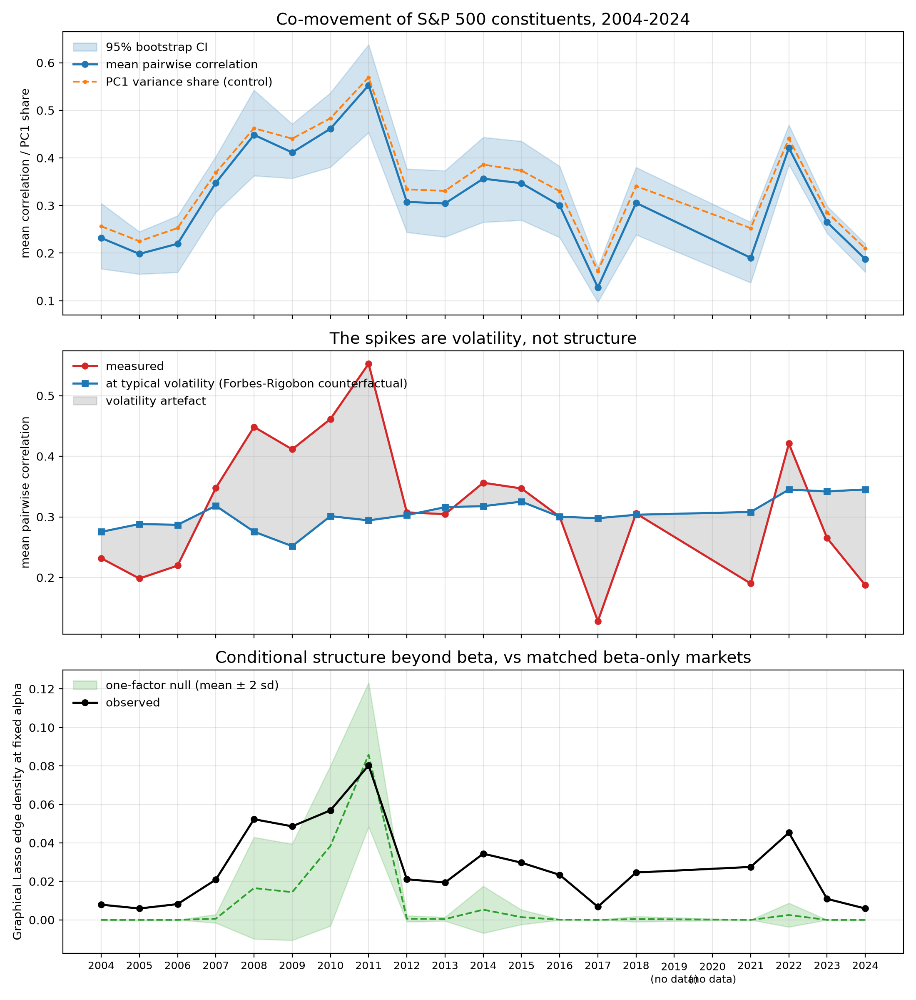

# Full analysis: how did the stock market change from 2004 to 2024?



## Summary

Mean pairwise correlation of daily returns between S&P 500 members roughly doubled from 0.20 in
2005 to 0.45 in 2008. It peaked at 0.55 in 2011, three years after the crisis year, fell to a
21-year low of 0.13 in 2017, rose again to 0.42 in the 2022 rate shock and was 0.19 in 2024. The
first principal component tracks this series to within about 0.02 every year, so what the series
measures is the strength of the single market factor.

That raises two questions, and the later sections answer both.

Is the level of correlation a volatility effect? Forbes and Rigobon (2002) show that measured
correlation rises mechanically with volatility. If I reset each year's factor and idiosyncratic
volatility to typical levels, keeping that year's loadings, the series flattens to roughly 0.25-0.35
in every year. None of the 2005 to 2008 rise survives, and 16% of the 2017 to 2022 move does. The
spikes come from the market factor becoming more volatile, while the stocks themselves are no more
interconnected than before.

Is there any conditional structure once the factor is removed? I simulated beta-only markets
matched to each year (same days, same stocks, same average correlation) and ran the same Graphical
Lasso on them. In 17 of 19 years the observed edge density is significantly above this one-factor
null. The two exceptions are 2010 and 2011, the crisis peak, where the network's densification
cannot be distinguished from what beta alone produces. A stable core of sector pairs and dual
listings, 0.6-0.8% of pairs in calm years, is real conditional structure. The crisis densification
comes from estimating under high correlation.

In practical terms, diversification inside the index weakens when it is most needed: a factor risk
model calibrated on 2017 covariance would have understated 2008- or 2022-style co-movement by a
factor of three. The cause is the volatility of the market factor. The pairwise dependencies between
stocks are few and have changed little in 21 years.

Some caveats belong up front. The 2008 rise in raw correlation is real, though the bootstrap
intervals for 2007 and 2008 barely separate, and the 2011 peak is not statistically distinguishable
from 2008. Before 2019 the price data covers about 40% of trading days, which costs roughly ±0.05
of accuracy (see [Data quality](#data-quality)). 2019 and 2020 could not be recovered, so COVID is
not in the analysis. The work is descriptive and does not test for contagion.

To reproduce the results, run notebooks 04 to 06, or without Jupyter run `python -m src.results`,
`python -m src.forbes_rigobon` and `python -m src.one_factor_null`.

| year | coverage | tickers | mean corr | 95% CI | PC1 share |
|-----:|---------:|--------:|----------:|:--------------|----------:|
| 2004 | 0.38 | 387 | 0.232 | 0.167 to 0.304 | 0.256 |
| 2005 | 0.38 | 391 | 0.198 | 0.156 to 0.245 | 0.225 |
| 2006 | 0.43 | 380 | 0.220 | 0.160 to 0.278 | 0.253 |
| 2007 | 0.50 | 371 | 0.348 | 0.286 to 0.403 | 0.369 |
| 2008 | 0.48 | 379 | 0.448 | 0.363 to 0.542 | 0.462 |
| 2009 | 0.43 | 390 | 0.411 | 0.357 to 0.471 | 0.440 |
| 2010 | 0.38 | 401 | 0.461 | 0.381 to 0.537 | 0.483 |
| 2011 | 0.40 | 404 | **0.553** | 0.453 to 0.638 | 0.569 |
| 2012 | 0.40 | 414 | 0.308 | 0.244 to 0.377 | 0.334 |
| 2013 | 0.40 | 418 | 0.304 | 0.234 to 0.373 | 0.331 |
| 2014 | 0.38 | 427 | 0.356 | 0.265 to 0.443 | 0.386 |
| 2015 | 0.44 | 425 | 0.347 | 0.269 to 0.435 | 0.373 |
| 2016 | 0.49 | 437 | 0.300 | 0.233 to 0.382 | 0.330 |
| 2017 | 0.43 | 447 | **0.128** | 0.097 to 0.170 | 0.162 |
| 2018 | 0.44 | 460 | 0.306 | 0.239 to 0.380 | 0.341 |
| 2019 | 0.10 | 465 | n/a | excluded | n/a |
| 2020 | 0.05 | 475 | n/a | excluded | n/a |
| 2021 | 0.35 | 474 | 0.190 | 0.138 to 0.265 | 0.252 |
| 2022 | 0.96 | 475 | 0.421 | 0.386 to 0.469 | 0.441 |
| 2023 | 0.96 | 476 | 0.265 | 0.242 to 0.299 | 0.286 |
| 2024 | 0.96 | 483 | 0.187 | 0.160 to 0.219 | 0.210 |

`coverage` is the share of the year's trading days present in the data. Check it before reading the
rest of the row.

## What this is testing

"Did the structure of the market change?" can't be measured directly, so I split it into four
narrower questions. Each is measured separately, and each could have come out negative.

### 1. How much do S&P 500 stocks move together, and does that change?

I measure this with the mean pairwise correlation of daily log returns within each calendar year.
If the series were flat, co-movement would be a constant of the market and there would be nothing
to explain. It ranges from 0.13 to 0.55, a four-fold spread, with the high years in 2008-2011 and
2022.

### 2. Is the co-movement one thing or many?

The share of total variance explained by the first principal component is the control for question
1. If correlation rose because the market became more interconnected, PC1 share and mean correlation
would diverge. They stay within about 0.02 of each other every year, so the series measures the
strength of the single market factor. A rising correlation heatmap is mostly beta, and this column
is the evidence for saying so.

### 3. Is any dependency left once the market factor is removed?

The Graphical Lasso estimates partial correlations: the dependency between two stocks after
conditioning on every other stock, which removes the common component behind question 2. The data
forces this choice anyway. With about 400 stocks and as few as 100 observed days in a year, the
sample covariance matrix is singular and cannot be inverted. The
[one-factor null](#is-there-structure-beyond-beta-the-one-factor-null) answers the question by
simulation: yes in most years, through a small and stable core, and no at the crisis peak.

### 4. Do stocks group by sector, and does that survive a crisis?

Affinity Propagation clusters each year's correlation matrix, and I compare the clusters with
sector labels. In calm years stocks should group by industry. In a panic, when everything falls
together, sector identity should give way to fewer and larger clusters. Cluster counts can only be
compared across years because `preference` is held fixed. With sklearn's default the count would
move whenever the distribution of similarities moved, which would make the comparison circular.

### Survivorship bias through a data filter

Two filters in the notebook silently deleted every stock that did not last the whole period: a
global coverage threshold at load time, and a second one inside the returns helper that fed the MDS
layout. Bear Stearns has 0.19 coverage of the 2004-2024 panel, Merrill Lynch 0.22, Wachovia 0.22,
National City 0.22 and Countrywide 0.19, and a `>= 0.50` test dropped all five. Filtering to
index-membership windows is necessary to avoid survivorship bias, but a data-hygiene threshold
further down the pipeline can bring the whole problem back. Both thresholds now admit short-lived
constituents, and each window's adequacy is checked separately.

### What this does not test

The analysis makes no causal claim. The bootstrap confidence intervals measure sampling uncertainty
in each year's estimate and say nothing about why correlation rose. The volatility adjustment below
attributes the spikes to volatility within the one-factor market model. Testing for contagion in
Forbes and Rigobon's sense would need cross-market data, which a single-index dataset does not have.

## Volatility or structure? The Forbes-Rigobon adjustment

Forbes and Rigobon (2002) show that measured correlation rises mechanically with volatility, so part
of any crisis spike is a statistical effect of turbulent markets. Their pairwise correction assumes
a single passive market, which does not describe an equity panel, so I use an adjustment that is
exact within the one-factor model the PC1 column supports.

For each year I estimate the market model `r_it = b_i·m_t + e_it` in return units, where m is the
equal-weighted market return. Its definition is the same every year, so each year's factor
volatility is identified separately. I then recompute the average pairwise correlation with that
year's market volatility and idiosyncratic variance scale reset to their typical 2004-2024 levels,
keeping the year's betas fixed.

The checks in `tests/test_forbes_rigobon.py` cover the two limiting cases. When turbulence comes
from the factor, measured correlation rises and the counterfactual recovers the calm level. When
factor and idiosyncratic volatility rise together, correlation is unchanged, and only resetting both
volatilities respects that.

| year | measured | at typical volatility | artefact | market vol (daily) |
|-----:|---------:|----------------------:|---------:|-------------------:|
| 2004 | 0.232 | 0.275 | −0.043 | 1.20% |
| 2005 | 0.198 | 0.288 | −0.090 | 1.01% |
| 2006 | 0.220 | 0.287 | −0.067 | 1.07% |
| 2007 | 0.348 | 0.318 | +0.029 | 1.42% |
| 2008 | 0.448 | 0.276 | +0.173 | 3.32% |
| 2009 | 0.411 | 0.252 | +0.160 | 3.00% |
| 2010 | 0.461 | 0.301 | +0.160 | 1.94% |
| 2011 | **0.553** | 0.294 | **+0.259** | 2.45% |
| 2012 | 0.308 | 0.303 | +0.005 | 1.31% |
| 2013 | 0.304 | 0.316 | −0.012 | 1.17% |
| 2014 | 0.356 | 0.318 | +0.039 | 1.33% |
| 2015 | 0.347 | 0.325 | +0.022 | 1.35% |
| 2016 | 0.300 | 0.300 | +0.000 | 1.32% |
| 2017 | **0.128** | 0.298 | **−0.170** | 0.67% |
| 2018 | 0.306 | 0.304 | +0.002 | 1.39% |
| 2021 | 0.190 | 0.308 | −0.118 | 1.09% |
| 2022 | 0.421 | 0.345 | +0.076 | 1.48% |
| 2023 | 0.265 | 0.342 | −0.077 | 0.90% |
| 2024 | 0.187 | 0.345 | −0.158 | 0.72% |

At typical volatility the series is flat at around 0.25-0.35. The 2011 peak and the 2017 low are the
same effect in opposite directions: factor variance in 2011 was 3.4 times its typical level, and in
2017 it was a quarter of it. The 2008 rise over 2005 is entirely volatility (−5% of the raw move
survives), and 16% of the 2017 to 2022 move survives. What remains in every year is the loading
structure, the average stock's sensitivity to the market. A structural claim about
interconnectedness would have to rest on that, and it barely moves.

## Is there structure beyond beta? The one-factor null

The Graphical Lasso's edge density might exceed what beta alone predicts, or it might only restate
the correlation level. To find out, for each year I simulate 200 beta-only markets with the same
number of observed days and tickers, each ticker's own loading profile and the same average pairwise
correlation. I then run the same estimation pipeline on them (the same fixed pooled alpha, ridge and
solver limits) and compare. The command is `python -m src.one_factor_null`, and the checks on the
null model's simulation and solver are in `tests/test_one_factor_null.py`.

| year | mean corr | observed density | null density | z | p (excess) |
|-----:|----------:|-----------------:|-------------:|--:|-----------:|
| 2004 | 0.228 | 0.008 | 0.000 | 166 | 0.005 |
| 2005 | 0.191 | 0.006 | 0.000 | 497 | 0.005 |
| 2006 | 0.216 | 0.008 | 0.000 | 506 | 0.005 |
| 2007 | 0.332 | 0.021 | 0.001 | 17.8 | 0.005 |
| 2008 | 0.437 | 0.052 | 0.017 | 2.7 | 0.025 |
| 2009 | 0.404 | 0.049 | 0.014 | 2.7 | 0.025 |
| 2010 | 0.456 | 0.057 | 0.038 | 0.9 | 0.199 |
| 2011 | 0.547 | 0.080 | 0.086 | −0.3 | 0.660 |
| 2012 | 0.303 | 0.021 | 0.001 | 27.1 | 0.005 |
| 2013 | 0.299 | 0.019 | 0.000 | 37.2 | 0.005 |
| 2014 | 0.357 | 0.034 | 0.005 | 4.8 | 0.010 |
| 2015 | 0.339 | 0.030 | 0.001 | 15.0 | 0.005 |
| 2016 | 0.294 | 0.023 | 0.000 | 155 | 0.005 |
| 2017 | 0.125 | 0.007 | 0.000 | 2400 | 0.005 |
| 2018 | 0.294 | 0.025 | 0.000 | 35.2 | 0.005 |
| 2021 | 0.190 | 0.028 | 0.000 | 662 | 0.005 |
| 2022 | 0.415 | 0.045 | 0.003 | 13.7 | 0.005 |
| 2023 | 0.259 | 0.011 | 0.000 | 3083 | 0.005 |
| 2024 | 0.185 | 0.006 | 0.000 | 2433 | 0.005 |

When the null density is zero its variance is zero too, so those z values are arbitrarily large and
only mean that the null is zero. The turbulent years are the informative rows: there the null has
some mass and z is a real signal-to-noise ratio.

In calm years the null density is exactly zero, because the L1 penalty removes the tiny partial
correlations a beta-only market produces. The real market always keeps a small core of dependencies,
such as the two Alphabet share classes, duopolies and spin-off pairs, and that core is real
conditional structure.

In the crisis years the null density becomes material. With about 100 observed days and about 410
stocks, sampling noise in the factor alone pushes partial correlations past the fixed penalty. In
2010 the observed density lies within the null's range, and in 2011 it is below the null mean (7 of
the 200 null draws for 2011 hit the solver's conditioning limit and are excluded; no other year lost
any). The densification of the network during the crisis, the most striking thing in the
animations, cannot be told apart from an estimator effect of high correlation. So the answer to
question 3 is no at the peak, and yes, but thinly, in the other years.

## What the network and clustering found

Both use hyperparameters fixed across years (see [Method](#method)), so each column can be compared
from year to year. `edge density` is the share of stock pairs that keep a non-zero partial
correlation after the L1 penalty, and `clusters` is the number of Affinity Propagation exemplars.

| year | mean corr | edge density | clusters |
|-----:|----------:|-------------:|---------:|
| 2004 | 0.232 | 0.008 | 47 |
| 2005 | 0.198 | 0.006 | 51 |
| 2006 | 0.220 | 0.008 | 45 |
| 2007 | 0.348 | 0.021 | 36 |
| 2008 | 0.448 | 0.052 | 28 |
| 2009 | 0.411 | 0.049 | 30 |
| 2010 | 0.461 | 0.057 | 26 |
| 2011 | **0.553** | **0.080** | **15** |
| 2012 | 0.308 | 0.021 | 36 |
| 2013 | 0.304 | 0.019 | 42 |
| 2014 | 0.356 | 0.034 | 33 |
| 2015 | 0.347 | 0.030 | 38 |
| 2016 | 0.300 | 0.023 | 43 |
| 2017 | **0.128** | **0.007** | **74** |
| 2018 | 0.306 | 0.025 | 46 |
| 2021 | 0.190 | 0.028 | 49 |
| 2022 | 0.421 | 0.045 | 35 |
| 2023 | 0.265 | 0.011 | 67 |
| 2024 | 0.187 | 0.006 | 82 |

The three series move together closely (Spearman, n=19):

| pair | rho | p |
|:--|--:|--:|
| mean correlation vs edge density | +0.88 | 6e-07 |
| mean correlation vs cluster count | −0.96 | 2e-10 |
| edge density vs cluster count | −0.88 | 8e-07 |

In 2011 the market had 15 clusters, and by 2024 it had 82. This is sector identity dissolving in a
panic, and it only shows up because `preference` is fixed: at sklearn's default the same series is
nearly flat, going from 38 in 2004 to 63 in 2024.

### A deflationary reading

A rank correlation of −0.96 is strong evidence that, with hyperparameters fixed, network density and
cluster count are both close to monotone transforms of the average correlation level. The three
methods are measuring one thing rather than confirming each other. The two simulations above test
where that one thing comes from. The Forbes-Rigobon counterfactual shows the correlation level is
mostly factor volatility, and the one-factor null shows the crisis-year network density can be
reproduced from beta alone. Put together, this project measures the volatility of the market factor
over 21 years in several ways, plus a thin, stable core of real conditional structure, and finds no
hidden interconnection.

## Reading the figures

`figures/summary.png` shows the whole project in one picture: the headline series with its PC1
control, the volatility counterfactual, and edge density against the one-factor null band.

`figures/stock_market_structure_mds.gif` has one frame per year. Each node is a stock, placed by
metric MDS on the full-sample correlation distance, so positions are fixed across frames and the
layout algorithm cannot create movement between years. Edges are the strongest partial correlations
from the Graphical Lasso, with thicker lines for stronger ones, and node colour shows sector.

`figures/stock_market_structure_affinity_propagation.gif` uses the same layout, but joins each node
to its cluster exemplar and colours it by cluster. The legend gives that year's cluster count.

Only the 40 most connected nodes in each frame are labelled, because labelling all of the roughly
500 stocks produces overlapping text. In the clustering frames those labels are mostly the
exemplars.

Two cautions apply to both animations. Each node keeps only its top-k strongest edges, so the total
edge count is fixed by construction and can't show whether the network became denser; use the tables
for that. MDS coordinates have no units, so only relative position means anything. Each frame's title
gives the share of the year's trading days it was built from, which is about 40% for frames before
2019.

## Data quality

The original Polygon pull returned far less data than it appeared to. When a request crossed the
account's history entitlement, Polygon answered `200 OK` with a partial payload. The ingest code
wrapped the call in `except Exception`, which catches a dropped connection or a 403 but not a
successful response containing 40% of the rows, and nothing downstream compared row counts with the
expected number of trading days. So 867 complete-looking CSVs landed on disk, and the correlation
matrices were computed on about 110 days a year while appearing to cover 252.

`src/repull_polygon.py` now ends with a coverage assertion. The general lesson is that an ingest
which only catches exceptions is unguarded, because rate- and entitlement-limited APIs usually fail
by returning part of the data.

I ruled out two other explanations. The bars themselves are exact: close, volume and transaction
count all match a fresh pull on 432 overlapping dates. The client library is also not at fault: its
chunk boundaries don't line up with the coverage gaps, and its full-range merge returns the same 817
bars as a single request.

To find out how much the sparsity distorts the results, I used 2022-2024, which are complete and so
have known true daily figures. Imposing a real sparse year's pattern of observed dates on them and
recomputing (`python -m src.sparse_bias_check`) gives an average bias of +0.025, ranging from −0.041
to +0.076. The shape of the 2004-2018 series can be trusted, since every year in it is sampled the
same way, but its level reads slightly high. Comparing a sparse year directly with a complete one
(2004 with 2024, for example) overstates the difference by roughly 0.03.

2019 and 2020 can't be recovered: the account's history window now starts on 2021-09-07, and
anything earlier returns 403. COVID is therefore not covered.

## Method

The universe is historical S&P 500 membership, so each stock contributes returns only for days it
was in the index, and delisted constituents (BSC, MER, WB, NCC, CFC) stay in. I use daily log
returns and compute correlations per calendar year over tickers that traded on at least 90% of that
year's observed dates. Confidence intervals come from 200 bootstrap samples of days.

1. `notebooks/01_data_preparation.ipynb`: the original Polygon pull, reshaping and filtering to
   membership windows.
2. `src/repull_polygon.py`: a re-pull of the window that is still available, with a completeness
   assertion.
3. `src/merge_repull.py`: joins the two pulls and reconciles split adjustment across pull dates.
4. `src/build_db.py`: loads everything into SQLite (`data/processed/market_data.db`).
5. `notebooks/04_yearly_results.ipynb` (via `src/results.py`): the headline table.
   `src/sparse_bias_check.py` produces the bias estimate.
6. `src/fetch_sectors.py`: fills in missing sector labels from yfinance.
7. `notebooks/02_market_structure_analysis.ipynb`: annual networks and animations.
8. `notebooks/05_volatility_or_structure.ipynb` and `notebooks/06_structure_beyond_beta.ipynb` (via
   `src/forbes_rigobon.py` and `src/one_factor_null.py`): the volatility counterfactual and the
   conditional-structure test. `src/plot_summary.py` draws the headline figure.

The estimation pipeline (return construction, Graphical Lasso at the fixed penalty, edge density) is
in `src/market_structure.py`, and both the notebook and the analysis scripts import it. The module
reproduces the notebook's yearly densities to machine precision, which is what makes the null
comparison valid. The test suite (`pytest`) checks every estimator on synthetic limiting cases:
independent noise, single-factor panels, simulated splits and regime switches.

Each pull is split-adjusted as of its own pull date, so a ticker that split between the two pulls
sits on two different price scales. Step 3 works out the split factor from overlapping dates and
rescales; without it a fake return would appear at the 2021-09-07 join. It found five real corporate
actions: APH 2:1, MNST 2:1, CRWD 4:1, DD 1:3 reverse and PARA 1:20 reverse. Each is confirmed by a
reciprocal volume ratio, which distinguishes a split from a reused ticker symbol.

### Why a network rather than a correlation matrix

Raw correlation between 500 stocks is dominated by the market factor, so a rising heatmap says
little beyond "beta went up", and the PC1 column shows how little. The Graphical Lasso gives partial
correlations: it conditions out the common component and leaves the conditional dependencies. With
about 400 stocks and 110 observed days a year the sample covariance is singular, so an
L1-regularised estimator is required.

The L1 penalty (`alpha`) and the Affinity Propagation `preference` are calibrated once on the pooled
sample and held fixed for every year. sklearn's defaults refit both each year: `GraphicalLassoCV`
picks a new penalty, and `AffinityPropagation` sets `preference` to the median input similarity.
Year-on-year edge and cluster counts would then partly reflect the estimator.

The network figures fix each node's degree at its top-k strongest edges, so the edge count in them
is constant by construction. Read density from the table.

## Limitations

- 2019 and 2020 are missing entirely, and 2021 is only 35% covered, so COVID is out of scope.
- Sparse sampling before 2019 biases the level by roughly +0.03 (measured above).
- Some survivorship bias remains. Membership filtering is correct and the crisis casualties are
  present, but 38 of 903 constituent tickers were never fetched, mostly post-bankruptcy symbols
  (ABKFQ, EKDKQ, DPHIQ, FNMA, FMCC), so the crisis years look slightly better than they were.
- The volatility counterfactual depends on a model. It is exact in the one-factor market model,
  which the PC1 column says fits this panel to within 0.02, but it puts all systematic variance into
  a single equal-weighted factor. The market proxy slightly attenuates betas (regressing on the
  equal-weighted return carries mean idiosyncratic noise), and the idiosyncratic rescaling uses one
  cross-sectional factor per year. The classic pairwise Forbes-Rigobon formula, reported in
  `figures/forbes_rigobon.csv`, points the same way and is more conservative.
- The one-factor null draws Gaussian noise. Real returns have fat tails, so some of the excess
  density in turbulent years may come from the distribution of returns. In 2011, 7 of 200 null
  draws hit the solver's conditioning limit and are excluded.
- Calendar-year windows are arbitrary. The crisis straddles the 2008/2009 boundary, and rolling
  windows would be a better design.
- MDS coordinates are fitted once on the full sample and reused for every frame, so positions can be
  compared across years but have no units.
- Sector labels come from yfinance (Morningstar-style) and are not GICS. 610 of 872 panel tickers
  (70%) have a label. Most of the other 262 are delisted symbols yfinance no longer serves, so the
  unlabelled stocks are concentrated in the early years, which is where the comparison of clusters
  with sectors is weakest.
- Some Graphical Lasso fits do not fully converge within 200 iterations (dual gaps around 0.05 in the
  high-correlation years). The densities are approximate, so small differences between adjacent years
  mean little. The large swings, such as 0.006 in 2024 against 0.080 in 2011, are well outside that
  margin.
- A ridge of 0.10 is added to each year's empirical correlation matrix before the Graphical Lasso
  fit. Without it 2011 is too ill-conditioned to solve (p=416 against n=105). The ridge is the same
  every year, and the ranking of yearly densities is unchanged for ridge values from 0.01 to 0.10, so
  it affects conditioning and leaves the result alone.

## Repository layout and reproduction

```
├── data/
│   ├── raw/                       # Polygon pulls, historical constituents, sector map
│   ├── interim/                   # recomputed pipeline stages (merge output, filters)
│   └── processed/                 # final membership panel, SQLite DB, cached calibration
├── notebooks/
│   ├── 01_data_preparation.ipynb  # original pull, reshape, membership filtering
│   ├── 02_market_structure_analysis.ipynb  # networks, clusters, animations
│   ├── 03_exploratory_correlation_heatmap.ipynb  # early exploration, kept for history
│   ├── 04_yearly_results.ipynb    # headline table: mean correlation, CIs, PC1
│   ├── 05_volatility_or_structure.ipynb  # Forbes-Rigobon counterfactual
│   └── 06_structure_beyond_beta.ipynb    # one-factor null test + summary figure
├── src/                           # pipeline and analysis scripts (see Method)
├── tests/                         # pytest self-checks on synthetic limiting cases
└── figures/                       # results tables (CSV), figures, animations
```

```bash
python -m venv .venv && source .venv/bin/activate
pip install -r requirements-dev.txt
pytest                                   # estimator self-checks, ~30 seconds
```

Then run the analysis notebooks in order: `04_yearly_results`, `05_volatility_or_structure` and
`06_structure_beyond_beta`. Notebook 06 takes about 30 minutes at its default 200 simulations. To run
the same steps without Jupyter:

```bash
python -m src.results                    # headline table
python -m src.forbes_rigobon             # volatility counterfactual
python -m src.one_factor_null --sims 200 # conditional-structure test
python -m src.plot_summary               # headline figure
```

`data/` is not committed because of its size. Re-create it with steps 1 to 4 of the Method and a
`POLYGON_KEY` in a `.env` file at the repository root. Step 1 can no longer reproduce the pre-2019
data on a current free-tier key.

## Data source

Historical constituents come from https://github.com/hanshof/sp500_constituents, which inspired this
repository. Prices come from the Polygon API.

### Disclaimer

I wrote the analysis and modelling, with AI assistance (opencode) for the repository restructure, the
null-simulation and volatility-adjustment implementations, and the documentation polish. Do not use
any of this to inform financial decisions.
