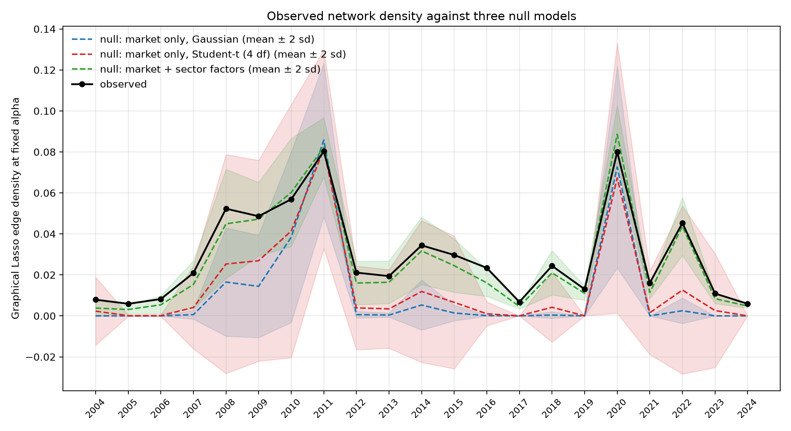
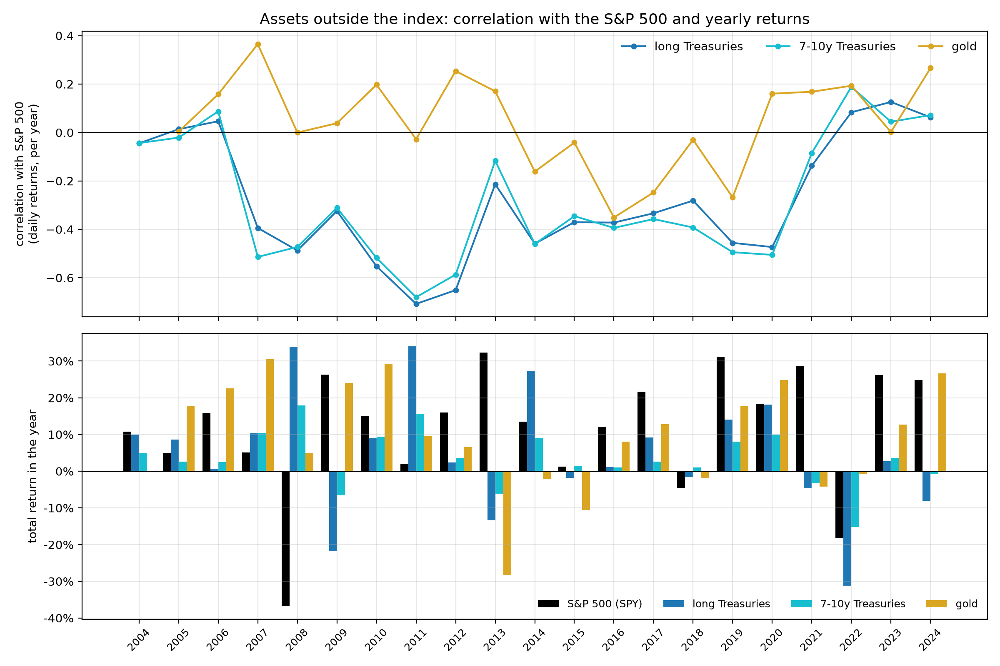

# Full analysis: how did the stock market change from 2004 to 2024?


## Summary

Mean pairwise correlation of daily returns between S&P 500 members roughly doubled from 0.20 in
2005 to 0.45 in 2008. It reached 0.55 in 2011 and again in 2020 (0.553 and 0.547, with overlapping
confidence intervals), fell to a 21-year low of 0.13 in 2017, rose to 0.42 in the 2022 rate shock
and was 0.19 in 2024. The first principal component tracks this series to within 0.035 every year,
so what the series measures is the strength of the single market factor.

Three questions follow, and the later sections answer each one.

Is the level of correlation a volatility effect? Forbes and Rigobon (2002) show that measured
correlation rises mechanically with volatility. If I reset each year's market and idiosyncratic
volatility to typical levels, keeping that year's betas, the series flattens to between 0.23 and
0.30 in every year, COVID included. None of the 2005 to 2008 rise survives, and 3% of the 2017 to
2022 move does. The spikes come from the market factor becoming more volatile; the way stocks load
on the market barely changes.

Is there any conditional structure once the market factor is removed? Against simulated beta-only
markets matched to each year, the Graphical Lasso network is denser in 18 of 21 years. The three
exceptions are 2010, 2011 and 2020, the highest-correlation years, where the network's
densification cannot be told apart from what beta alone produces. Two harder nulls shrink the
remaining structure further. With fat-tailed noise the excess is significant in 7 of 21 years, and
a model with sector factors on top of the market reproduces most of the network in every year: the
observed density beats it only in 2017, 2021, 2023 and 2024, and only by about 0.001 to 0.005.
What is left beyond sectors is a thin layer of pair-specific links, such as share classes and
spin-offs.

Does it matter for risk? A risk model calibrated on 2017 understated the realised volatility of an
equal-weight portfolio of these stocks by 3.2 times in 2022 and 5.6 times in 2020. Resetting the
model to typical volatility halves those misses but does not remove them, and neither model sees a
crisis coming a year ahead. Outside the index, Treasuries offset losses in 2008 and 2020 but fell
further than stocks in 2022.

Some caveats belong up front. Before 2019 the price data covers about 40% of trading days, which
biases the correlation level up by about 0.03 (see [Data quality](#data-quality)). 2019 to 2021
come from yfinance, which no longer serves companies delisted since then, so 36 to 50 stocks that
were in the index all year are missing from each of those years. The work is descriptive and does
not test for contagion.

To reproduce the results, run notebooks 04 to 07, or the scripts listed under
[Repository layout and reproduction](#repository-layout-and-reproduction).

| year | coverage | tickers | members excluded | mean corr | 95% CI | PC1 share |
|-----:|---------:|--------:|--------:|----------:|:--------------|----------:|
| 2004 | 0.38 | 387 | 53 of 440 | 0.232 | 0.167 to 0.304 | 0.256 |
| 2005 | 0.38 | 391 | 52 of 443 | 0.198 | 0.156 to 0.245 | 0.225 |
| 2006 | 0.43 | 380 | 45 of 425 | 0.220 | 0.160 to 0.278 | 0.253 |
| 2007 | 0.50 | 371 | 42 of 413 | 0.348 | 0.286 to 0.403 | 0.369 |
| 2008 | 0.48 | 379 | 35 of 413 | 0.448 | 0.363 to 0.542 | 0.462 |
| 2009 | 0.43 | 390 | 30 of 417 | 0.411 | 0.357 to 0.471 | 0.440 |
| 2010 | 0.38 | 401 | 34 of 435 | 0.461 | 0.381 to 0.537 | 0.483 |
| 2011 | 0.40 | 404 | 33 of 436 | **0.553** | 0.453 to 0.638 | 0.569 |
| 2012 | 0.40 | 414 | 29 of 442 | 0.308 | 0.244 to 0.377 | 0.334 |
| 2013 | 0.40 | 418 | 26 of 443 | 0.304 | 0.234 to 0.373 | 0.331 |
| 2014 | 0.38 | 427 | 22 of 449 | 0.356 | 0.265 to 0.443 | 0.386 |
| 2015 | 0.44 | 425 | 19 of 444 | 0.347 | 0.269 to 0.435 | 0.373 |
| 2016 | 0.49 | 437 | 17 of 454 | 0.300 | 0.233 to 0.382 | 0.330 |
| 2017 | 0.43 | 447 | 17 of 464 | **0.128** | 0.097 to 0.170 | 0.162 |
| 2018 | 0.44 | 460 | 13 of 473 | 0.306 | 0.239 to 0.380 | 0.341 |
| 2019 | 0.96 | 421 | 50 of 471 | 0.255 | 0.208 to 0.303 | 0.285 |
| 2020 | 0.96 | 435 | 46 of 481 | **0.547** | 0.468 to 0.614 | 0.562 |
| 2021 | 0.96 | 444 | 36 of 480 | 0.251 | 0.216 to 0.292 | 0.280 |
| 2022 | 0.96 | 477 | 0 of 477 | 0.421 | 0.375 to 0.468 | 0.441 |
| 2023 | 0.96 | 478 | 1 of 479 | 0.265 | 0.233 to 0.308 | 0.286 |
| 2024 | 0.96 | 484 | 0 of 484 | 0.187 | 0.162 to 0.218 | 0.209 |

`coverage` is the share of the year's trading days present in the data; check it before reading
the rest of the row. `members excluded` counts stocks that were in the index for the whole year but
are missing from the calculation, out of all such stocks. `tickers` also includes stocks that were
members for only part of the year.

## What this is testing

"Did the structure of the market change?" can't be measured directly, so I split it into narrower
questions. Each is measured separately, and each could have come out negative.

### 1. How much do S&P 500 stocks move together, and does that change?

I measure this with the mean pairwise correlation of daily log returns within each calendar year.
If the series were flat, co-movement would be a constant of the market and there would be nothing
to explain. It ranges from 0.13 to 0.55, a four-fold spread, with the high years in 2008-2011,
2020 and 2022.

### 2. Is the co-movement one thing or many?

The share of total variance explained by the first principal component is the control for question
1. If correlation rose because the market became more interconnected, PC1 share and mean
correlation would diverge. They stay within 0.035 of each other every year, so the series measures
the strength of the single market factor. A rising correlation heatmap is mostly beta, and this
column is the evidence for saying so.

### 3. Is any dependency left once the market factor is removed?

The Graphical Lasso estimates partial correlations: the dependency between two stocks after
conditioning on every other stock, which removes the common component behind question 2. The data
forces this choice anyway. With about 400 stocks and as few as 100 observed days in a year, the
sample covariance matrix is singular and cannot be inverted. The
[null tests](#is-there-structure-beyond-beta-the-null-tests) answer the question by simulation.

### 4. Do stocks group by sector, and does that survive a crisis?

Affinity Propagation clusters each year's correlation matrix. In calm years stocks should group by
industry. In a panic, when everything falls together, sector identity should give way to fewer and
larger clusters. Cluster counts can only be compared across years because `preference` is held
fixed. With sklearn's default the count would move whenever the distribution of similarities
moved, which would make the comparison circular.

### 5. Would any of this have changed a decision?

The [out-of-sample risk test](#out-of-sample-risk-test) calibrates two risk models on one year and
measures how far they miss the next. The [cross-asset check](#assets-outside-the-index) looks at
whether Treasuries or gold offset the index's losses in the turbulent years.

### Survivorship bias through data filters

Filters that look like routine data hygiene have removed short-lived stocks three times in this
project. The first version applied a `>= 0.50` coverage threshold to the whole 2004-2024 panel,
which deleted Bear Stearns (0.19 coverage), Merrill Lynch (0.22), Wachovia (0.22), National City
(0.22) and Countrywide (0.19). Lowering it to 0.05 fixed that, but once 2019-2021 were filled in,
the larger number of dates pushed 45 more tickers under 0.05, including 2024 additions such as
Palantir, Dell, CrowdStrike and KKR. The panel-wide threshold is now gone; each window has its own
adequacy check. Separately, the constituents list spells Berkshire Hathaway and Brown-Forman
`BRK-B` and `BF-B` until 2023 and `BRK.B` and `BF.B` after, and Polygon writes the dotted form, so
both companies failed the membership filter in every year. Normalising the spelling restores them
from 2019; the original pull only fetched the dotted symbol, which covers 2023 onwards, so earlier
years can't be recovered.

### What this does not test

The analysis makes no causal claim. The bootstrap confidence intervals measure sampling uncertainty
in each year's estimate and say nothing about why correlation rose. The volatility adjustment
attributes the spikes to volatility within the one-factor market model. Testing for contagion in
Forbes and Rigobon's sense would need cross-market data, which a single-index dataset does not have.

## Volatility or structure? The Forbes-Rigobon adjustment

Forbes and Rigobon (2002) show that measured correlation rises mechanically with volatility, so part
of any crisis spike is a statistical effect of turbulent markets. Their pairwise correction assumes
a single passive market, which does not describe an equity panel, so I use an adjustment that is
exact within the one-factor model the PC1 column supports.

For each year I estimate the market model `r_it = b_i·m_t + e_it`, where m is the equal-weighted
market return. Its definition is the same every year, so each year's factor volatility is
identified separately. I then recompute the average pairwise correlation with that year's market
volatility and idiosyncratic variance reset to their typical 2004-2024 levels, keeping the year's
betas fixed. Volatilities are annualised as variance per observation times observations in the
year, because before 2019 a single observation can span several trading days.

An earlier version used per-observation variances. That mixed the sparse years with the complete
ones: stocks that joined the index after 2019 had typical levels measured only on complete data,
while the market's typical level was dominated by sparse years. The adjusted series drifted upwards
after 2019 as a result, and the share of the 2017 to 2022 rise that survived the adjustment was
overstated at 16%. Annualising fixed both.

The checks in `tests/test_forbes_rigobon.py` cover the two limiting cases. When turbulence comes
from the factor, measured correlation rises and the counterfactual recovers the calm level. When
factor and idiosyncratic volatility rise together, correlation is unchanged, and only resetting both
volatilities respects that.

| year | measured | at typical volatility | artefact | market vol (annualised) |
|-----:|---------:|----------------------:|---------:|-------------------:|
| 2004 | 0.232 | 0.289 | −0.057 | 12% |
| 2005 | 0.198 | 0.290 | −0.092 | 10% |
| 2006 | 0.220 | 0.283 | −0.064 | 11% |
| 2007 | 0.348 | 0.294 | +0.054 | 16% |
| 2008 | 0.448 | 0.263 | +0.185 | 37% |
| 2009 | 0.411 | 0.231 | +0.181 | 32% |
| 2010 | 0.461 | 0.289 | +0.172 | 19% |
| 2011 | 0.553 | 0.292 | +0.260 | 25% |
| 2012 | 0.307 | 0.288 | +0.019 | 13% |
| 2013 | 0.304 | 0.298 | +0.007 | 12% |
| 2014 | 0.356 | 0.296 | +0.061 | 13% |
| 2015 | 0.347 | 0.301 | +0.046 | 15% |
| 2016 | 0.300 | 0.278 | +0.022 | 15% |
| 2017 | 0.128 | 0.269 | −0.141 | 7% |
| 2018 | 0.306 | 0.287 | +0.018 | 15% |
| 2019 | 0.255 | 0.283 | −0.028 | 13% |
| 2020 | 0.547 | 0.294 | +0.253 | 39% |
| 2021 | 0.251 | 0.273 | −0.021 | 14% |
| 2022 | 0.421 | 0.278 | +0.144 | 23% |
| 2023 | 0.266 | 0.268 | −0.002 | 14% |
| 2024 | 0.187 | 0.257 | −0.070 | 11% |

At typical volatility the series stays between 0.23 and 0.30. The high and low years have the same
cause: market variance was 6.9 times its typical level in 2008, 7.7 times in 2020 and 3.1 times in
2011, and a quarter of it in 2017. The 2008 rise over 2005 is entirely volatility (−11% of the raw
move survives), and 3% of the 2017 to 2022 move survives. What remains in every year is the loading
structure, the average stock's sensitivity to the market. A structural claim about
interconnectedness would have to rest on that, and it barely moves.

## Timing: six-month rolling windows

Calendar years split the 2008 crisis in two, so `src/rolling.py` repeats the correlation and
volatility adjustment on six-month windows ending at each month end.


In the window ending August 2008 correlation was 0.23, lower than at any point that year. It rose
to 0.27 in the window ending September, 0.37 in October and 0.50 in November, as annualised market
volatility went from 17% to 46%: the rise followed Lehman's collapse rather than leading it. COVID
was faster. Correlation went from 0.29 in the window ending February 2020 to 0.62 in the window
ending March, and volatility from 14% to 44%. The highest window ends in December 2011 at 0.66 and
the lowest in November 2017 at 0.11. At typical volatility the rolling series stays between 0.22
and 0.32 throughout.

## Is there structure beyond beta? The null tests

The Graphical Lasso's edge density might exceed what beta alone predicts, or it might only restate
the correlation level. To find out, for each year I simulate beta-only markets with the same number
of observed days and tickers, each ticker's own loading profile and the same average pairwise
correlation, run the same estimation pipeline on them (the same fixed pooled alpha, ridge and
solver limits), and compare. The command is `python -m src.one_factor_null`, and the checks on the
null models are in `tests/test_one_factor_null.py`.

| year | mean corr | observed density | null density | z | p (excess) |
|-----:|----------:|-----------------:|-------------:|--:|-----------:|
| 2004 | 0.228 | 0.008 | 0.000 | 149 | 0.005 |
| 2005 | 0.191 | 0.006 | 0.000 | 497 | 0.005 |
| 2006 | 0.216 | 0.008 | 0.000 | 506 | 0.005 |
| 2007 | 0.332 | 0.021 | 0.001 | 17.8 | 0.005 |
| 2008 | 0.437 | 0.052 | 0.017 | 2.7 | 0.025 |
| 2009 | 0.404 | 0.049 | 0.014 | 2.7 | 0.025 |
| 2010 | 0.456 | 0.057 | 0.038 | 0.9 | 0.199 |
| 2011 | 0.547 | 0.080 | 0.086 | −0.3 | 0.660 |
| 2012 | 0.303 | 0.021 | 0.001 | 27.1 | 0.005 |
| 2013 | 0.299 | 0.019 | 0.000 | 37.2 | 0.005 |
| 2014 | 0.357 | 0.034 | 0.005 | 4.8 | 0.010 |
| 2015 | 0.339 | 0.030 | 0.001 | 15.0 | 0.005 |
| 2016 | 0.294 | 0.023 | 0.000 | 155 | 0.005 |
| 2017 | 0.125 | 0.007 | 0.000 | 2400 | 0.005 |
| 2018 | 0.293 | 0.024 | 0.000 | 29.2 | 0.005 |
| 2019 | 0.252 | 0.013 | 0.000 | 3014 | 0.005 |
| 2020 | 0.524 | 0.080 | 0.073 | 0.3 | 0.413 |
| 2021 | 0.246 | 0.016 | 0.000 | 4015 | 0.005 |
| 2022 | 0.416 | 0.045 | 0.003 | 13.9 | 0.005 |
| 2023 | 0.259 | 0.011 | 0.000 | 2843 | 0.005 |
| 2024 | 0.184 | 0.006 | 0.000 | 2295 | 0.005 |

This table uses 200 simulations per year. Mean correlation here differs slightly from the headline
table because the network pipeline admits stocks present on more than half of a year's dates,
where the headline table requires 90%. When the null density is zero its variance is zero too, so
those z values are arbitrarily large and only mean that the null is zero. The turbulent years are
the informative rows: there the null has some mass and z is a real signal-to-noise ratio.

In calm years the null density is exactly zero, because the L1 penalty removes the tiny partial
correlations a beta-only market produces, while the real market always keeps some links. In the
highest-correlation years the null density becomes material: with about 100 to 250 observed days
and 400 to 450 stocks, sampling noise in the factor alone pushes partial correlations past the fixed
penalty. In 2010 and 2020 the observed density lies within the null's range, and in 2011 it is below
the null mean (7 of the 200 null draws for 2011 hit the solver's conditioning limit and are
excluded). The densification of the network during crises, the most striking thing in the
animations, can't be told apart from an estimator effect of high correlation.

### Two harder nulls

The Gaussian null has two weaknesses: real returns have fat tails, and stocks share sector exposure
as well as market exposure. Two variants test each in turn, at 50 simulations per year, so the
smallest p-value they can report is 0.02.

- Student-t noise with 4 degrees of freedom, scaled to the same variance (`--noise t`).
- A market-plus-sector model (`--model sector`): each stock keeps its market beta, and within each
  sector a one-factor factor analysis of the market residuals gives a sector loading. Factor
  analysis is used because regressing a stock on its sector's average is biased either way: with the
  stock included its own noise inflates the loading, and with it left out the noisier regressor
  attenuates it. Sector factors are drawn with their estimated correlation, because removing the
  market leaves them slightly negatively correlated. Stocks without a sector label load on the
  market only.

| year | observed density | Gaussian null | p | Student-t null | p | market + sector null | p |
|-----:|--:|--:|--:|--:|--:|--:|--:|
| 2004 | 0.0079 | 0.0000 | 0.005 | 0.0023 | 0.098 | 0.0038 | 0.059 |
| 2005 | 0.0059 | 0.0000 | 0.005 | 0.0001 | 0.020 | 0.0031 | 0.059 |
| 2006 | 0.0082 | 0.0000 | 0.005 | 0.0001 | 0.020 | 0.0054 | 0.118 |
| 2007 | 0.0209 | 0.0006 | 0.005 | 0.0041 | 0.078 | 0.0153 | 0.176 |
| 2008 | 0.0523 | 0.0165 | 0.025 | 0.0253 | 0.225 | 0.0449 | 0.353 |
| 2009 | 0.0486 | 0.0144 | 0.025 | 0.0269 | 0.160 | 0.0472 | 0.471 |
| 2010 | 0.0569 | 0.0384 | 0.199 | 0.0414 | 0.306 | 0.0602 | 0.588 |
| 2011 | 0.0803 | 0.0858 | 0.660 | 0.0813 | 0.565 | 0.0823 | 0.657 |
| 2012 | 0.0211 | 0.0006 | 0.005 | 0.0039 | 0.060 | 0.0160 | 0.196 |
| 2013 | 0.0194 | 0.0004 | 0.005 | 0.0034 | 0.059 | 0.0164 | 0.275 |
| 2014 | 0.0344 | 0.0053 | 0.010 | 0.0119 | 0.118 | 0.0317 | 0.353 |
| 2015 | 0.0297 | 0.0014 | 0.005 | 0.0066 | 0.078 | 0.0245 | 0.216 |
| 2016 | 0.0234 | 0.0001 | 0.005 | 0.0010 | 0.020 | 0.0161 | 0.059 |
| 2017 | 0.0068 | 0.0000 | 0.005 | 0.0000 | 0.020 | 0.0046 | 0.020 |
| 2018 | 0.0244 | 0.0004 | 0.005 | 0.0042 | 0.060 | 0.0210 | 0.294 |
| 2019 | 0.0130 | 0.0000 | 0.005 | 0.0000 | 0.020 | 0.0110 | 0.157 |
| 2020 | 0.0800 | 0.0726 | 0.413 | 0.0673 | 0.367 | 0.0886 | 0.857 |
| 2021 | 0.0161 | 0.0000 | 0.005 | 0.0015 | 0.039 | 0.0114 | 0.020 |
| 2022 | 0.0453 | 0.0025 | 0.005 | 0.0126 | 0.098 | 0.0437 | 0.471 |
| 2023 | 0.0109 | 0.0000 | 0.005 | 0.0026 | 0.078 | 0.0084 | 0.039 |
| 2024 | 0.0059 | 0.0000 | 0.005 | 0.0000 | 0.020 | 0.0048 | 0.039 |



Fat tails weaken the test without removing the gap. The average Student-t null is about a fifth of
the observed density, but occasional fat-tailed draws produce dense networks, which widens the
null's range: the excess is significant in 7 of 21 years and borderline (p between 0.06 and 0.1) in
most of the others. Sector factors do much more. The market-plus-sector null reproduces between
half and all of the observed density in every year, and three quarters or more in 14 of 21 years.
The observed network beats it only in 2017, 2021, 2023 and 2024, by 0.001 to 0.005. The links that survive the one-factor test are mostly sector structure.
What sectors don't explain is a thin layer of pair-specific links such as the two Alphabet share
classes, duopolies and spin-off pairs, and it is only detectable in calm years.

## What the network and clustering found

Both use hyperparameters fixed across years (see [Method](#method)), so each column can be compared
from year to year. `edge density` is the share of stock pairs that keep a non-zero partial
correlation after the L1 penalty, and `clusters` is the number of Affinity Propagation exemplars
(`python -m src.market_structure` writes both to `figures/clusters.csv`).

| year | mean corr | edge density | clusters |
|-----:|----------:|-------------:|---------:|
| 2004 | 0.232 | 0.008 | 48 |
| 2005 | 0.198 | 0.006 | 51 |
| 2006 | 0.220 | 0.008 | 45 |
| 2007 | 0.348 | 0.021 | 36 |
| 2008 | 0.448 | 0.052 | 28 |
| 2009 | 0.411 | 0.049 | 30 |
| 2010 | 0.461 | 0.057 | 26 |
| 2011 | **0.553** | **0.080** | **15** |
| 2012 | 0.308 | 0.021 | 36 |
| 2013 | 0.304 | 0.019 | 42 |
| 2014 | 0.356 | 0.034 | 33 |
| 2015 | 0.347 | 0.030 | 38 |
| 2016 | 0.300 | 0.023 | 43 |
| 2017 | **0.128** | **0.007** | **74** |
| 2018 | 0.306 | 0.024 | 46 |
| 2019 | 0.255 | 0.013 | 52 |
| 2020 | **0.547** | **0.080** | **24** |
| 2021 | 0.251 | 0.016 | 50 |
| 2022 | 0.421 | 0.045 | 35 |
| 2023 | 0.265 | 0.011 | 67 |
| 2024 | 0.187 | 0.006 | 82 |

The three series move together closely (Spearman, n=21):

| pair | rho | p |
|:--|--:|--:|
| mean correlation vs edge density | +0.97 | 8e-13 |
| mean correlation vs cluster count | −0.94 | 2e-10 |
| edge density vs cluster count | −0.93 | 2e-09 |

The market had 15 clusters in 2011, 24 in 2020 and 82 in 2024. This is sector identity dissolving
in a panic, and it only shows up because `preference` is fixed: at sklearn's default the count
drifts from 40 in 2004 to 63 in 2024 with no dip in 2011 or 2020.

### A deflationary reading

A rank correlation of −0.94 is strong evidence that, with hyperparameters fixed, network density and
cluster count are both close to monotone transforms of the average correlation level. The three
methods are measuring one thing rather than confirming each other. The simulations above show where
that one thing comes from. The Forbes-Rigobon counterfactual shows the correlation level is mostly
market volatility, the one-factor null shows the crisis-year network density can be reproduced from
beta alone, and the sector null shows most of the calm-year network is sector exposure. Put
together, this project measures the volatility of the market factor over 21 years in several ways,
plus sector structure and a thin layer of pair-specific links, and finds no hidden interconnection.

## Out-of-sample risk test

`src/oos_risk.py` asks whether the finding would have changed a risk forecast. Each year it
calibrates two models and predicts the next year's volatility of two portfolios.

- The sample model uses that year's covariance matrix. Minimum-variance weights need an inverse,
  which the sample matrix doesn't have when stocks outnumber days, so the optimiser uses the
  Ledoit-Wolf shrunk version. The equal-weight prediction uses the plain matrix, because shrinkage
  pulls correlations towards zero and would understate that portfolio's variance.
- The typical-volatility model keeps that year's betas but resets market and idiosyncratic
  volatility to their median over the calibration year and the years before it. That is the
  Forbes-Rigobon counterfactual used as a forecast, with no future data.

The bias ratio is realised volatility over predicted; above 1 means the model understated risk.
Calibrated on 2017, the calmest year in the sample:

| test year | sample model, predicted | typical model, predicted | realised | sample model, understated by | typical model, understated by |
|-----:|--:|--:|--:|--:|--:|
| 2018 | 7% | 14% | 15% | 2.1× | 1.05× |
| 2019 | 7% | 14% | 12% | 1.8× | 0.90× |
| 2020 | 7% | 14% | 39% | 5.6× | 2.9× |
| 2021 | 7% | 14% | 14% | 1.9× | 1.00× |
| 2022 | 7% | 13% | 22% | 3.2× | 1.7× |
| 2023 | 7% | 13% | 14% | 2.0× | 1.04× |
| 2024 | 7% | 13% | 11% | 1.6× | 0.85× |

(Equal-weight portfolio, annualised volatility.)


A model built on 2017's covariance understated every later year, by 1.6 times even in calm 2024 and
5.6 times in 2020. The typical-volatility model is close in non-crisis years and halves the miss in
2020 and 2022. Calibrated on the previous year instead, the typical model is somewhat more accurate
on average (mean absolute log bias 0.35 against 0.42) mainly because it avoids the large
overstatements that follow a crisis year, but neither model anticipates a crisis: the worst
understatement is about 3.2 times for both, in 2008 and 2020.

Minimum-variance portfolios were understated in every year by both models, by 1.6 to 18 times. The
optimiser concentrates in stocks that looked quiet in the calibration year, and that estimation
error is larger than any volatility-regime effect. The typical-volatility model does worse here,
because its diagonal idiosyncratic covariance ignores the sector structure found above.

## Assets outside the index

`src/cross_asset.py` compares the S&P 500 (SPY) with long Treasuries (TLT), 7-10 year Treasuries
(IEF) and gold (GLD, from November 2004), using total returns from yfinance.

| year | S&P 500 | long Treasuries | correlation with S&P | gold | correlation with S&P |
|-----:|--:|--:|--:|--:|--:|
| 2008 | −36.8% | +34.0% | −0.49 | +4.9% | −0.00 |
| 2020 | +18.3% | +18.2% | −0.47 | +24.8% | +0.16 |
| 2022 | −18.2% | −31.2% | +0.08 | −0.8% | +0.19 |



Treasuries were negatively correlated with the index from 2007 to 2020 (between −0.28 and −0.71 in
most years) and offset losses on the index's worst days: on SPY's worst 5% of days since 2004, long
Treasuries returned +0.86% on average and 7-10 year Treasuries +0.40%, against −2.98% for SPY. In
2022 the correlation turned positive and long Treasuries lost more than the index. Gold was close
to uncorrelated in most years and averaged −0.13% on SPY's worst days. So protection can come from
outside the index, but whether it does depends on why the index is falling: Treasuries helped when
the shock was a growth scare and hurt when it was a rate shock.

## Reading the figures

`figures/summary.png` shows the core result in one picture: the headline series with its PC1
control, the volatility counterfactual, and edge density against the one-factor null band.

`figures/stock_market_structure_mds.gif` has one frame per year. Each node is a stock, placed by
metric MDS on the full-sample correlation distance, so positions are fixed across frames and the
layout algorithm cannot create movement between years. Edges are the strongest partial correlations
from the Graphical Lasso, with thicker lines for stronger ones, and node colour shows sector.

`figures/stock_market_structure_affinity_propagation.gif` uses the same layout, but joins each node
to its cluster exemplar and colours it by cluster. The legend gives that year's cluster count.

Only the 40 most connected nodes in each frame are labelled, because labelling all of the roughly
500 stocks produces overlapping text. In the clustering frames those labels are mostly the
exemplars.

Two cautions apply to both animations. Each node keeps only its top-k strongest edges, so the total
edge count is fixed by construction and can't show whether the network became denser; use the tables
for that. MDS coordinates have no units, so only relative position means anything. Each frame's title
gives the share of the year's trading days it was built from, which is about 40% for frames before
2019.

## Data quality

The original Polygon pull returned far less data than it appeared to. When a request crossed the
account's history entitlement, Polygon answered `200 OK` with a partial payload. The ingest code
wrapped the call in `except Exception`, which catches a dropped connection or a 403 but not a
successful response containing 40% of the rows, and nothing downstream compared row counts with the
expected number of trading days. So 867 complete-looking CSVs landed on disk, and the correlation
matrices were computed on about 110 days a year while appearing to cover 252.

`src/repull_polygon.py` now ends with a coverage assertion. The general lesson is that an ingest
which only catches exceptions is unguarded, because rate- and entitlement-limited APIs usually fail
by returning part of the data.

I ruled out two other explanations. The bars themselves are exact: close, volume and transaction
count all match a fresh pull on 432 overlapping dates. The client library is also not at fault: its
chunk boundaries don't line up with the coverage gaps, and its full-range merge returns the same 817
bars as a single request.

To find out how much the sparsity distorts the results, I used 2022-2024, which are complete and so
have known true daily figures. Imposing a real sparse year's pattern of observed dates on them and
recomputing (`python -m src.sparse_bias_check`) gives an average bias of +0.025, ranging from −0.041
to +0.075. The shape of the 2004-2018 series can be trusted, since every year in it is sampled the
same way, but its level reads slightly high. Comparing a sparse year directly with a complete one
(2004 with 2024, for example) overstates the difference by roughly 0.03.

### Filling 2019-2021 from yfinance

The Polygon account's history now starts on 2021-09-07, and the original pull held only 5-10% of
trading days for 2019 and 2020. `src/fetch_gap_yfinance.py` pulls daily prices from yfinance for
every ticker that was in the index at some point between 2019-01-01 and 2021-09-06. yfinance's
`Close` is split-adjusted but not dividend-adjusted, which matches Polygon. `src/merge_repull.py`
rescales each ticker onto the panel's price basis using overlapping dates and only uses it if the
median price gap on those dates is under 1%, which rules out a reused ticker symbol.

Companies that changed symbol but are the same legal entity, such as FB (now META), ANTM (ELV) and
UTX (RTX), are fetched under their current symbol; acquisitions are left out, because an acquirer's
price history is not the target's. BB&T is one of these: it renamed itself Truist, and yfinance now
serves an unrelated security under "BBT", which the overlap check rejected until the rename was
mapped. In the end yfinance served 496 of the 558 gap-year members, 495 passed the overlap check
(SL Green did not) and the rest stay on their sparse Polygon rows.

Most of those 62 are companies delisted since 2021, such as Celgene, Twitter, Xilinx and SVB. They
fail the 90% coverage rule for 2019-2021 and drop out of those years, which is the `members
excluded` column in the headline table. To see whether that matters, I took the complete years
2022-2024 and removed the stocks that 2020 lost (or 2008 lost) wherever they were still members:
mean correlation moved by at most 0.0024. That check can only use stocks that kept trading, so it
can't rule out bias from the delisted ones themselves.

## Method

The universe is historical S&P 500 membership, so each stock contributes returns only for days it
was in the index, and delisted constituents (BSC, MER, WB, NCC, CFC) stay in. I use daily log
returns and compute correlations per calendar year over tickers that traded on at least 90% of that
year's observed dates. Confidence intervals come from 200 bootstrap samples of days.

1. `notebooks/01_data_preparation.ipynb`: the original Polygon pull, reshaping and filtering to
   membership windows.
2. `src/repull_polygon.py`: a re-pull of the window that is still available, with a completeness
   assertion.
3. `src/fetch_gap_yfinance.py`: daily prices for 2019-2021 from yfinance.
4. `src/merge_repull.py`: joins the three sources and reconciles split adjustment across them.
5. `src/build_db.py`: loads everything into SQLite (`data/processed/market_data.db`).
6. `notebooks/04_yearly_results.ipynb` (via `src/results.py`): the headline table.
   `src/sparse_bias_check.py` produces the bias estimate.
7. `src/fetch_sectors.py`: fills in missing sector labels from yfinance.
8. `notebooks/02_market_structure_analysis.ipynb`: annual networks and animations, then
   `python -m src.market_structure` for the cluster counts and Spearman table.
9. `notebooks/05_volatility_or_structure.ipynb` and `notebooks/06_structure_beyond_beta.ipynb` (via
   `src/forbes_rigobon.py` and `src/one_factor_null.py`): the volatility counterfactual and the null
   tests. `src/plot_summary.py` draws the headline figure.
10. `notebooks/07_extensions.ipynb` (via `src/rolling.py`, `src/oos_risk.py` and
    `src/cross_asset.py`): rolling windows, the out-of-sample risk test and the cross-asset view.

The estimation pipeline (return construction, Graphical Lasso at the fixed penalty, edge density) is
in `src/market_structure.py`, and both the notebook and the analysis scripts import it. The test
suite (`pytest`) checks every estimator on synthetic limiting cases: independent noise,
single-factor and sector-factor panels, simulated splits and regime switches.

Each source is split-adjusted as of its own pull date, so a ticker that split between pulls sits on
different price scales. The merge works out the factor from overlapping dates and rescales; without
it a fake return would appear at each join. It found five real corporate actions between the two
Polygon pulls: APH 2:1, MNST 2:1, CRWD 4:1, DD 1:3 reverse and PARA 1:20 reverse. Each is confirmed
by a reciprocal volume ratio, which distinguishes a split from a reused ticker symbol.

### Why a network rather than a correlation matrix

Raw correlation between 500 stocks is dominated by the market factor, so a rising heatmap says
little beyond "beta went up", and the PC1 column shows how little. The Graphical Lasso gives partial
correlations: it conditions out the common component and leaves the conditional dependencies. With
about 400 stocks and 110 observed days a year the sample covariance is singular, so an
L1-regularised estimator is required.

The L1 penalty (`alpha`) and the Affinity Propagation `preference` are calibrated once on the pooled
sample and held fixed for every year. sklearn's defaults refit both each year: `GraphicalLassoCV`
picks a new penalty, and `AffinityPropagation` sets `preference` to the median input similarity.
Year-on-year edge and cluster counts would then partly reflect the estimator. The calibration was
done before 2019-2021 were added and is cached; keeping it fixed keeps the earlier years comparable.

The network figures fix each node's degree at its top-k strongest edges, so the edge count in them
is constant by construction. Read density from the table.

## Limitations

- Before 2019 about 40% of trading days are present, which biases the level by roughly +0.03
  (measured above). 2019-2021 come from a different source (yfinance) than the other years.
- Some survivorship bias remains. 13 to 53 full-year members are missing per year before 2019,
  mostly tickers the original Polygon pull never fetched, and 36 to 50 per year in 2019-2021,
  mostly companies delisted since. Dropping the same stocks from complete years moves the result by
  less than 0.003, but that check can't cover the delisted companies themselves.
- The volatility counterfactual depends on a model. It is exact in the one-factor market model,
  which the PC1 column says fits this panel to within 0.035, but it puts all systematic variance
  into a single equal-weighted factor. The market proxy slightly attenuates betas (regressing on the
  equal-weighted return carries mean idiosyncratic noise), and the idiosyncratic rescaling uses one
  cross-sectional factor per year. The classic pairwise Forbes-Rigobon formula, reported in
  `figures/forbes_rigobon.csv`, points the same way and is more conservative.
- The Student-t and sector nulls use 50 simulations per year, so their p-values can't go below
  0.02. Sector labels come from yfinance (Morningstar-style) and are not GICS; 610 of 872 panel
  tickers (70%) have a label, and the unlabelled ones, mostly delisted symbols concentrated in the
  early years, load on the market only in the sector null.
- Calendar-year windows are arbitrary; the rolling windows address the timing question but are only
  computed for correlation and volatility, not for the network.
- MDS coordinates are fitted once on the full sample and reused for every frame, so positions can be
  compared across years but have no units.
- Some Graphical Lasso fits do not fully converge within 200 iterations (dual gaps around 0.05 in the
  high-correlation years), and 2020 needs the LARS solver because coordinate descent fails at the
  fixed ridge. LARS minimises the same objective and agrees with coordinate descent to within 0.002
  where both run (2011, 2022). Small differences between adjacent years mean little; the large
  swings, such as 0.006 in 2024 against 0.080 in 2011 and 2020, are well outside that margin.
- A ridge of 0.10 is added to each year's empirical correlation matrix before the Graphical Lasso
  fit. Without it 2011 is too ill-conditioned to solve (p=416 against n=105). The ridge is the same
  every year, and the ranking of yearly densities is unchanged for ridge values from 0.01 to 0.10.
- The out-of-sample test uses this panel's stocks with equal or optimised weights, not the
  cap-weighted index, and annualises sparse years from multi-day returns.

## Repository layout and reproduction

```
├── data/
│   ├── raw/                       # Polygon pulls, yfinance gap fill, constituents, sector map
│   ├── interim/                   # recomputed pipeline stages (merge output, filters)
│   └── processed/                 # final membership panel, SQLite DB, cached calibration
├── notebooks/
│   ├── 01_data_preparation.ipynb  # original pull, reshape, membership filtering
│   ├── 02_market_structure_analysis.ipynb  # networks, clusters, animations
│   ├── 03_exploratory_correlation_heatmap.ipynb  # early exploration, kept for history
│   ├── 04_yearly_results.ipynb    # headline table: mean correlation, CIs, PC1
│   ├── 05_volatility_or_structure.ipynb  # Forbes-Rigobon counterfactual
│   ├── 06_structure_beyond_beta.ipynb    # one-factor null test + summary figure
│   └── 07_extensions.ipynb        # rolling windows, out-of-sample risk, cross-asset, harder nulls
├── src/                           # pipeline and analysis scripts (see Method)
├── tests/                         # pytest self-checks on synthetic limiting cases
└── figures/                       # results tables (CSV), figures, animations
```

```bash
python -m venv .venv && source .venv/bin/activate
pip install -r requirements-dev.txt
pytest                                   # estimator self-checks, a few seconds
```

Then run the analysis notebooks in order: `04_yearly_results`, `05_volatility_or_structure`,
`06_structure_beyond_beta` and `07_extensions`. Notebooks 06 and 07 read the saved null results by
default, because rerunning them takes one to two hours. To run the same steps without Jupyter:

```bash
python -m src.results                          # headline table
python -m src.forbes_rigobon                   # volatility counterfactual
python -m src.one_factor_null --sims 200       # one-factor null
python -m src.one_factor_null --sims 50 --noise t       # fat-tailed null
python -m src.one_factor_null --sims 50 --model sector  # market + sector null
python -m src.market_structure                 # cluster counts (after notebook 02)
python -m src.rolling                          # six-month rolling windows
python -m src.oos_risk                         # out-of-sample risk test
python -m src.cross_asset                      # Treasuries and gold
python -m src.plot_summary                     # headline figure
```

`data/` is not committed because of its size. Re-create it with steps 1 to 5 of the Method and a
`POLYGON_KEY` in a `.env` file at the repository root. Step 1 can no longer reproduce the pre-2019
data on a current free-tier key.

## Data source

Historical constituents come from https://github.com/hanshof/sp500_constituents, which inspired this
repository. Prices come from the Polygon API, with 2019-2021 and the cross-asset ETFs from yfinance.

### Disclaimer

I wrote the analysis and modelling, with AI assistance (opencode) for the repository restructure, the
null-simulation and volatility-adjustment implementations, and the documentation polish. Do not use
any of this to inform financial decisions.
